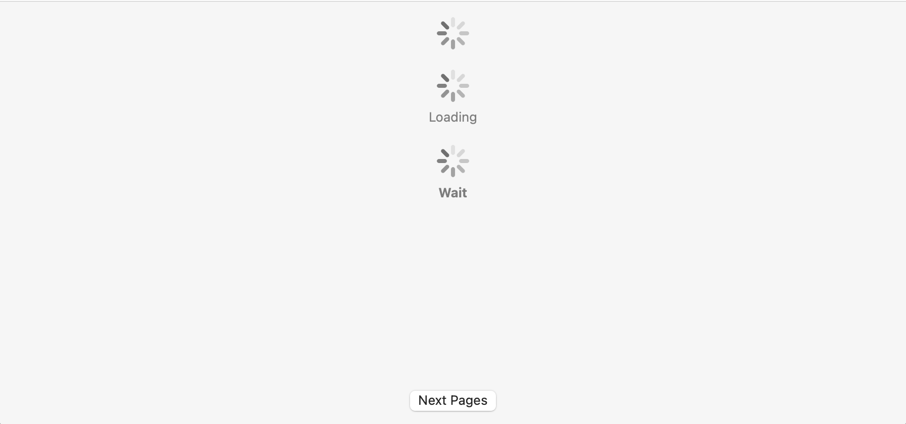
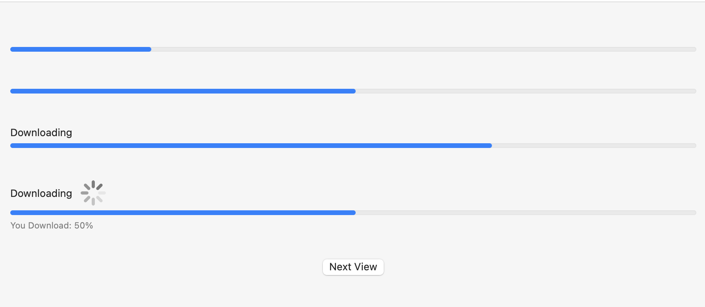
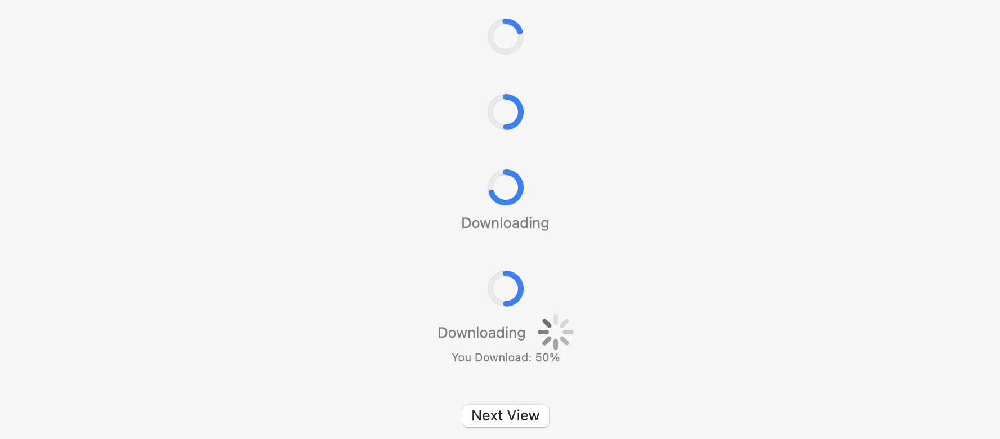
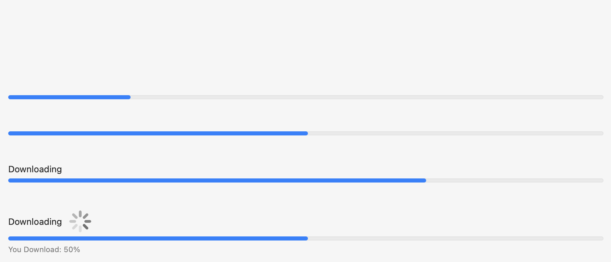
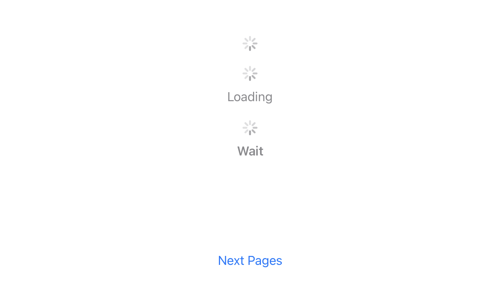
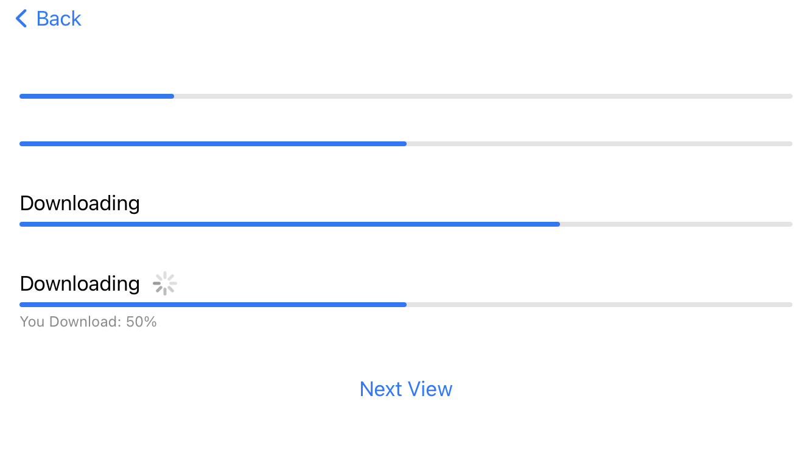
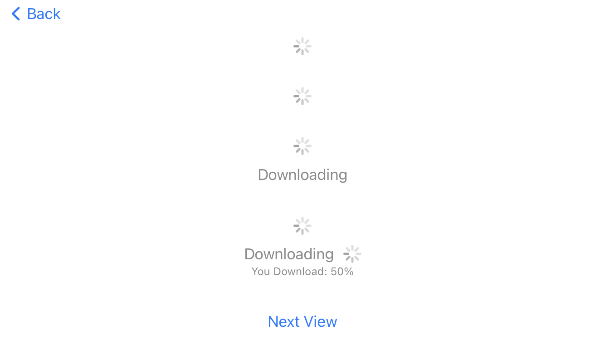
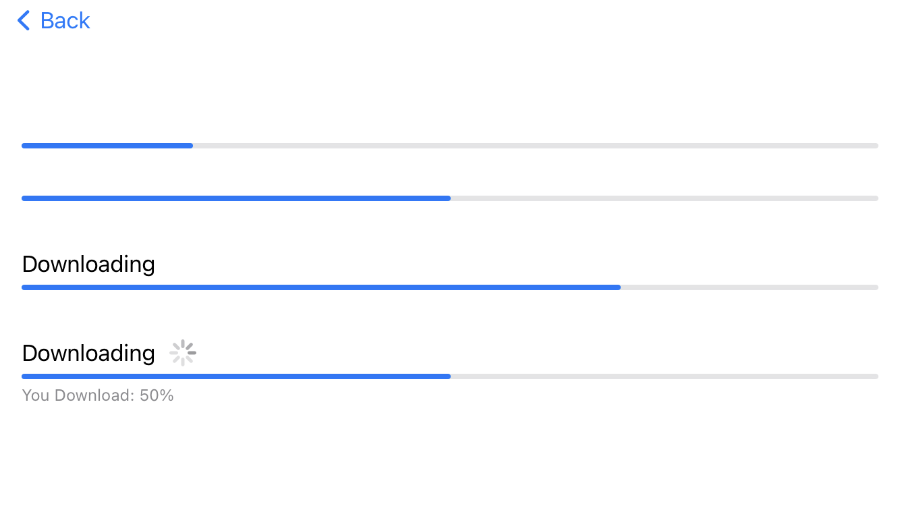

# Progress Bar or ProgressView On macOS and iOS using SwiftUI
ProgressView comes with two built-in styles.

LinearProgressViewStyle
CircularProgressViewStyle
Circular style only supported on macOS. 
For iOS, it appears as indeterminate progress.

Here is an example of the same ProgressView with different styles

### macOS Photo 1

### macOS Photo 2
macOS supports both circular and linear styles.

### macOS Photo 3

### macOS Photo 4

### iPhone Photo 1

### iPhone Photo 2
For iOS, a circular style does not support determinate progress and shows as a spinner.

### iPhone Photo 3

### iPhone Photo 4

